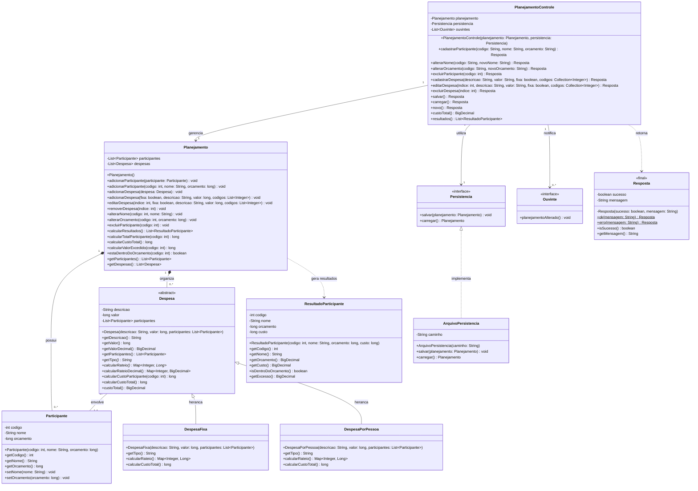

# Diagrama de Classes UML — Cabe no Bolso

O diagrama representa a estrutura das principais classes do sistema Cabe no Bolso, contemplando o modelo de domínio, as operações de negócio, os relacionamentos entre objetos, os mecanismos de abstração e herança e a interface de persistência.

