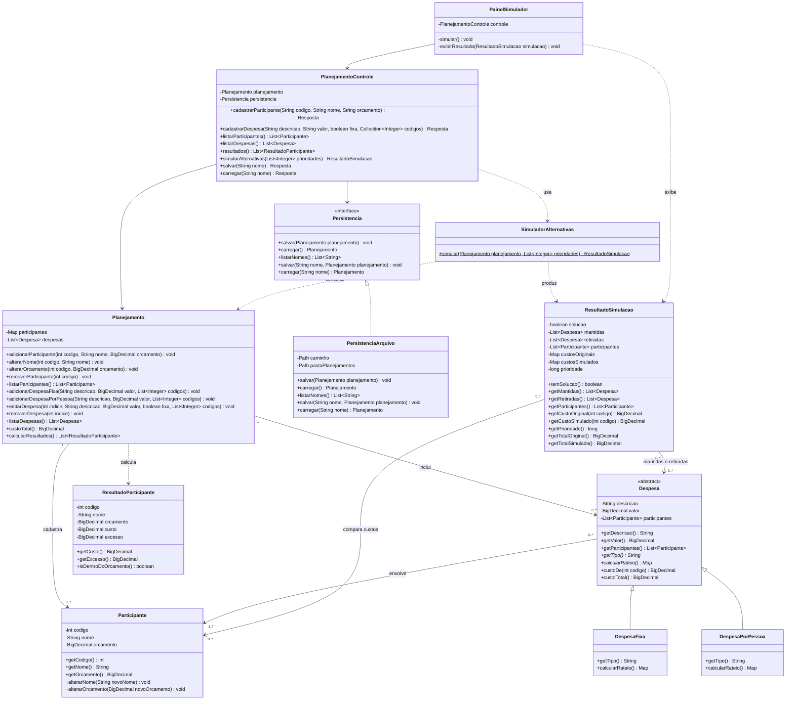

# Diagrama de classes

O diagrama representa as classes principais do modelo, da persistência e do
objetivo extra, incluindo a ligação do simulador com o controle e a interface.
Para manter a leitura, são mostrados os atributos e as operações principais,
sem detalhar todos os métodos auxiliares e componentes Swing.

